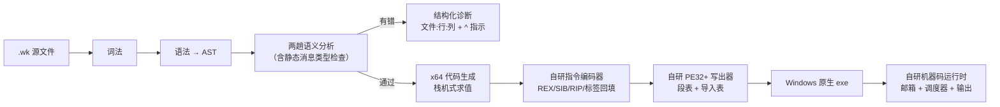

# Whisker

一个 **Actor 模型 + 静态编译** 的高级语言。目标很直接：**让并发变简单，而且简单得是结构性的，而不是靠纪律。**

**编译链路完全自研**：Python 前端 → 自研 x86-64 指令编码器 → 自研 PE 写出器 → Windows 原生 exe。
**不用 C、不用 C++、不用 LLVM、不用链接器、零 libc** —— 语言运行时也是用我自己生成的机器码写的。

已内置系统原语（TCP socket / 进程启动 / 时钟）与动态字符串标准库，实战项目见
[EonOS 系统](https://github.com/mouse1fish/eonos)（纯 Whisker 的 HTTP 网关 + 命令执行器 + agent 原语 + vLLM 直连）。

- 📄 设计思路与规划：见 [`Whisker语言设计草案.md`](./Whisker语言设计草案.md)
- 📜 **设计原则（宪法）**：四条原则 + 不做的事清单，见 [`交接文档-自举完成.md`](./交接文档-自举完成.md) 第 11 节
- 🗓️ 当前进度、踩坑记录与断点：见 [`进度.md`](./进度.md)
- 📚 **语言教程**（安装→入门→语法→内置函数→排障）：见 [`教程.md`](./教程.md)
- 📦 **便携 SDK**（解压任意目录即用）：见 [`sdk/whisker-sdk/`](./sdk/whisker-sdk/)，分发 zip 为 [`sdk/whisker-sdk-2026-11-03.zip`](./sdk/whisker-sdk-2026-11-03.zip)
- 🎮 **3D 引擎**（定点软件光栅化 + Z-buffer + GDI 窗口，~320 FPS）：见 [demos/3d/](./demos/3d/)
- 🏆 **自举已完成**（编译器用自己写、自己编译、**产物与自身逐字节一致**）：见 [`交接文档-自举完成.md`](./交接文档-自举完成.md)；日常构建用 `tools/selfbuild.ps1`（Windows 原生，无需 Python）；
  编译器已支持 CLI：`build\wkcc2.exe 源.wk [输出.exe]`

```
actor Counter {
    total: Int = 0

    on Inc[n: Int] {
        total = total + n
    }

    on Get[reply: ActorRef[Main]] {
        reply.send(Report(total))
    }
}

actor Main {
    on Start {
        c: ActorRef[Counter] = spawn Counter
        c.send(Inc(3))
        c.send(Inc(4))
        c.send(Inc(35))
        c.send(Get(self))
    }

    on Report[total: Int] {
        print("Counter 累加结果 = ", total)   // → 42
    }
}
```

### 语句风格：Python 味的写法

写成 **Python 那样舒服**，但保留 C 的花括号结构（这样括号层次才立得住）：

| 写法 | 说明 |
|---|---|
| 换行就是语句结束 | 不用写分号；想写也行（C 背景的人顺手） |
| 条件不带括号 | `if x > 0 {`、`while i < n {`；写了括号也能解析 |
| 变量第一次赋值就诞生 | `i = 0` 就是声明；要显式类型就写注解 `count: Int = 0` |
| 不用 `var` / `let` | 已经不是关键字（旧写法仍然接受） |
| `and` / `or` / `not` | 与 `&&` / `||` / `!` 完全等价，两种都认 |
| `True` / `False` | 与 `true` / `false` 等价 |
| `#` 和 `//` | 都是行注释 |
| `'单引号'` 和 `"双引号"` | 都能写字符串 |
| `1_000_000` | 数字可以用下划线分隔 |
| `elif` | 也可以用 `else if` |
| `def 名字[参数] -> 返回类型 { }` | 函数可以访问本 actor 的字段，也能递归；不写 `->` 就是没有返回值 |
| `for i in 0 .. n { }` | 区间循环：`..` 不含上界，`..=` 含上界 |
| `break` / `continue` | 提前退出 / 跳到下一轮 |
| `buf: Int[4096]` | 固定长度数组：可作字段（嵌在 actor 里）、局部（栈上）、参数（按引用传）；下标带边界检查 |
| `readFile(路径, 数组, 字节数)` / `writeFile(路径, 数组, 字节数)` | 字节级文件读写（写编译器必需） |
| `0x57_4B_4F_31` | 十六进制字面量，下划线照样能用 |
| `p: Ptr` + `alloc / ptrAdd / load8 / store8 / load64 / store64 / copyBytes / isNull` | 底层指针与内存原语（写编译器用；指针不参与消息传递） |
| `strLen / strCat / intToStr` | 字符串长度 / 拼接（新分配）/ 整数转字符串 |
| `readBytes / writeBytes` | 以指针为缓冲区的文件读写 |

> 完整演示见 `examples/syntax.wk`、`tests/x64/funcs.wk`、`tests/x64/arrays.wk`、`tests/x64/ptr.wk`。
> `examples/wko.wk` 用数组 + 文件读写落盘 **Whisker 自己的文件格式** `.wko`（magic `WKO1` + 版本 + 长度 + 载荷）。
> `tests/x64/ptr.wk` 用这些原语在 Whisker 里实现了一个**会自动扩容的字节缓冲区**——编译器攒字节/token 靠它。

### 一句话读完的语言示例

```
actor Shop {
    rate: Int = 10

    def tax[amount: Int] -> Int {       # 函数：参数用中括号，返回类型用 ->
        return amount * rate / 100
    }

    def is_big[amount: Int] -> Bool {
        return amount > 1000
    }

    on Buy[amount: Int, reply: ActorRef[Main]] {
        total: Int = 0
        for i in 1 ..= 3 {              # 含上界的区间循环
            if i % 2 == 0 {
                continue
            }
            total = total + amount
        }
        reply.send(Total(total + tax(amount)))
    }
}
```

### 括号层次：一眼看出结构规模

只用三种括号，**括号越大，包住的结构越大**：

| 括号 | 层次 | 用途 |
|---|---|---|
| `{ }` | 最大 | actor 定义、代码块、消息处理体 |
| `[ ]` | 中等 | 消息参数、类型参数 `ActorRef[Main]` |
| `( )` | 最小 | 消息构造、调用参数、表达式分组 |

```
actor Player {                                        ← {} 最大：一个 actor
    peer: ActorRef[Player];                       ← [] 中等：类型参数
    on Connect[p: ActorRef[Player], h: ActorRef[Main]] {   ← [] 消息参数 + {} 处理体
        peer = p;
        peer.send(Hop(n + 1, left - 1));              ← () 最小：消息构造
    }
}
```

空参数列表的中括号可省略：`on Start { ... }`。

## 为什么值得做

在 C 里写并发，难的不是语法，而是三件缺失的东西：**没有运行时**（线程 = OS 线程，几千个就崩）、**异步全靠手写状态机**、**没有内存模型**（数据竞争是 UB，编译器不帮你）。

Whisker 把这三件事都收进语言和运行时：

| | C | Whisker |
|---|---|---|
| 并发单位 | OS 线程（1~8MB 栈） | Actor（一次结构体分配） |
| 共享状态 | 共享内存 + 锁纪律 | **不共享可变状态**，只能发消息 |
| 传错消息类型 | 运行时崩溃或静默错误 | **编译期报错**（`actor Counter 没有消息 on Decrement`） |
| 数据竞争 | UB，靠人查 | 结构上不可能 |
| 忘记 join / 线程泄漏 | 常见事故 | 不存在：调度器自动静止检测 |

## 快速开始

`.wk` 源码直接编译成原生 exe，**默认走自研 x64 后端，不需要安装任何编译器**：

```bat
REM 编译并运行
python -m whiskerc run examples\counter.wk

REM 只看前端口（词法 / 语法 / 语义检查）
python -m whiskerc check examples\counter.wk

REM 打印机器码清单（各函数在段内的偏移）
python -m whiskerc build examples\counter.wk --dump-asm

REM 也可以走启动器
whisker.bat run tests\bank.wk
```

可选参数：

```
-o 名字            指定产物名（默认取源文件名）
--backend x64      自研 x86-64 后端（默认）：直接产出 PE，无 C/C++/LLVM/链接器
--backend c        M0 的 C 引导后端（对照/降级用，需要 MSVC）
--dump-asm         打印机器码清单
```

C 引导后端只作**对照验证**用：同一份源码两个后端跑出来的输出会逐字比对（见验收脚本）。

## 编译管线



## 示例与测试

| 文件 | 演示什么 |
|---|---|
| `examples/hello.wk` | 最小程序（入口 `actor Main` + `on Start`） |
| `examples/counter.wk` | 有状态 Actor + 请求/应答 |
| `examples/pingpong.wk` | 两个 Actor connect 成环互抛 20 万条消息，由 Main 监督汇总 |
| `examples/fanout.wk` | 同一道计算题：串行 vs 64 个 Actor 分片，结果逐位比对 |
| `tests/ordering.wk` | 10 万条消息 FIFO 顺序与不丢消息校验 |
| `tests/sieve.wk` | 素数统计（循环 / 取模 / 标志位控制流） |
| `tests/mapreduce.wk` | 32 分片汇总，与独立计算结果比对 |
| `tests/bank.wk` | 2 万笔转账后总额守恒（含 actor 屏障推理） |
| `examples/bad/*.wk` | 反例：编译期抓出"不存在的消息""参数类型错""if 条件不是 Bool" |

```bat
REM 全量验收：x64 后端跑通 + 与 C 后端逐字比对 + 反例被拦下
python tools\verify.py

REM 后端排查工具
python tools\dbg_x64.py        REM 容器 → 运行时 → 打印，逐级验证
python tools\dbg_bisect.py     REM 按功能二分定位崩溃
```

## 自举路线（已完成 ✅）

编译器的终极验收：**用 Whisker 写 Whisker 的编译器，产物与自身逐字节一致（fixpoint）**。

| 步骤 | 状态 |
|---|---|
| ① 语言能跑（前端 + 自研后端 + 运行时） | ✅ M0/M1 |
| ② 去掉 C / LLVM（自研编码器 + PE 写出器） | ✅ |
| ③ 语法定型（Python 味语句 + 括号层次 + 函数 + 控制流） | ✅ |
| ④~⑧ 基础设施 → 词法器 → 语法分析器逐字/逐字节比对 | ✅ 21 样本全一致 |
| ⑨ 自研后端（blob 嵌入 + PE 生成器）· 全语言代码发射 | ✅ |
| ⑩ **自举完成：`wkcc2.exe` 编译自身，产物逐字节一致；Python 版退役为应急引导** | ✅ **2026-10-28** |

之后持续加固（2026-11）：`and/or` 短路语义、`ptrToInt/intToPtr`、strbuf 标准库、
系统原语（TCP/进程/时钟）、agent 原语（截图/鼠标/键盘）、四 DLL 导入表、
帧动态对齐（根治嵌套调用栈未对齐）、**CLI 参数化**（`wkcc2 源.wk [输出.exe] [blob]`）。

> `whiskerc`（Python 前端）现仅作**应急引导链**保留：`wkcc2` 损坏时可重建，
> 日常构建零 Python（`tools/selfbuild.ps1` 一条命令）。


## 当前状态

**自举完成（fixpoint 逐字节一致）+ 系统能力扩展**。

- **编译链路**：`whiskerc` 前端 → 自研 x86-64 编码器 → 自研 PE 写出器 → Windows 原生 exe；
  自举编译器 `wkcc2.exe`（Whisker 写成）日常构建零 Python。**无 C / C++ / LLVM / 链接器 / libc**。
- **并发**：24 工作线程池 + 全局自旋锁 + 事件唤醒；主线程等系统静止。
- **语言能力**：Actor + 消息、`def`、区间循环、数组（带边界检查）、`Ptr` 与内存原语、
  字符串内置、`and/or` 短路、指针 cast（`ptrToInt/intToPtr`）、`cmdline()`。
- **系统原语**：TCP socket（含回环绑定）/ 进程启动与管道捕获 / 墙钟与睡眠。
- **agent 原语**：截屏（GDI→BMP）/ 鼠标 / 键盘（虚拟键码）。
- **标准库**：`strbuf`（动态字符串，倍增扩容）。
- **工具链**：CLI 编译（`wkcc2 源.wk [输出.exe] [blob]`）、便携 SDK、`wk.ps1` 构建驱动。
- **验收**：`verify_cp` **21/21** · `verify_boot` **15/15**（自举侧语义，含缺陷固化用例）·
  `verify_sys` **3/3 ×双编译器**（系统原语）· `selfbuild.ps1` fixpoint 复验。
- **实测性能**：`fanout` 并行段 49ms（约 1.5× MSVC -O2 的等价 C）；调度 20 万消息级场景全绿。

**已知欠账**：`use`/include（现用 def 片段拼接）、`defer`、错误码约定（strerror 注册表）、
跨 actor 前向 spawn、keep-alive、静态文件 >256KB 流式（截屏另走 8MB 专用路由）。
详见 [`进度.md`](./进度.md) 断点与 [`交接文档-自举完成.md`](./交接文档-自举完成.md)（含设计宪法第 11 节）。
