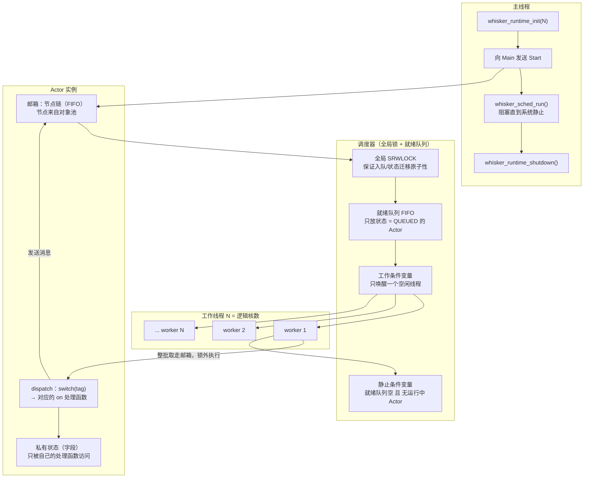
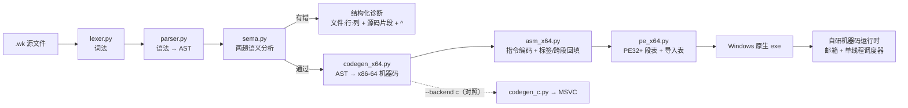

# Whisker 语言设计草案

> 版本：v0.1（M0 已落地）
> 编译器：`whiskerc`（Python 实现的前端 + C 引导后端）
> 运行时：`runtime/whisker_runtime.c`（Win32 线程 + 自研 M:N 调度器）
> 项目根：`H:\trea-xiancheng-bianyiqi`

---

## 一、为什么会有 Whisker

起点是一个很朴素的不满：**在 C 里把并发写对、写好，成本高得不合理。**

不是语法难写，而是三个结构性缺失：

1. **没有运行时**：C 的线程就是 OS 线程，1:1 绑定；线程栈 1~8MB + 内核对象，几千个就崩。"海量并发"在资源模型上就不可达。
2. **异步是程序员的活**：没有轻量协程，没有语言级调度，异步只能靠手写状态机/回调（或者用 ucontext 手动切栈 —— 平台相关、非标准）。**这份复杂性本该由编译器和运行时承担。**
3. **没有内存模型**：数据竞争是 UB，编译器不帮你。跨线程对象生命周期全靠人脑 + 锁纪律，而这恰恰最容易出错。

Whisker 的答案：**把"并发安全"从程序员的纪律问题，变成语言的结构性事实。**

> Whisker 这个名字取"胡须/触须"之意：每个 Actor 用一根根触须（邮箱）感知外界，轻、快、灵敏。

---

## 二、设计目标

| 目标 | 说明 |
|---|---|
| **并发默认安全** | 没有共享可变状态 → 数据竞争在语言结构上不可能发生（不是"约定不要这么写"，是"写不出来"） |
| **并发默认便宜** | Actor 是调度单位而不是线程；起十万个 Actor 不该是工程问题 |
| **静态可查** | 发给某个 Actor 的消息必须是它声明过的 `on` 处理，参数类型必须匹配——**编译期就抓住**，不等到运行时 |
| **无颜色问题** | 没有 `async` 传染：处理消息的写法就是普通同步代码 |
| **编译为原生** | 静态编译型语言，输出原生 exe；最终后端为自研 LLVM IR 后端 |
| **渐进落地** | 每一小步都能跑、能验证、能演示，不追求一次到位 |

### 非目标（至少 M0/M1 阶段）

- 不做操作系统级并发（不做 CPU 亲和性、实时调度保证）
- 不追求与 C ABI 完全互操作（M0 的 C 后端只是自举手段，不是产品接口）
- 不在 M0 做 GC、不做分布式、不做热更新

---

## 三、并发模型：Actor + 消息 + 邮箱

### 3.1 三条铁律

1. **Actor 的私有状态只能被它自己改**。每个 Actor 有独立的字段空间；处理函数永远在且仅在一个工作线程上跑。
2. **Actor 之间只通过消息通信**。消息信封在发送时被拷贝（值语义），接收方拿到的是自己的副本，不共享堆对象。
3. **消息按到达顺序处理（邮箱 FIFO）**，一次一条，天然串行化——所以单个 Actor 内部不需要任何锁。

由这三条直接推出：**数据竞争不可能发生**。不是靠"小心别写错"，是类型系统和运行时共同保证的。

### 3.2 消息即声明

消息不是某个"消息类"，而是 Actor 声明的处理函数：

```
actor Counter {
    total: Int = 0

    on Inc[n: Int] {          // ← 这就是消息 Inc，参数就是它的载荷
        total = total + n;
    }

    on Get[reply: ActorRef[Main]] {
        reply.send(Report(total))
    }
}
```

`ActorRef[Counter]` 带着类型信息，所以编译器知道"`Counter` 只有 `Inc` 和 `Get` 两个消息、参数分别是什么"，于是：

```
c.send(Decrement(1));      // 编译期报错：actor Counter 没有消息 on Decrement
c.send(Inc("三"));         // 编译期报错：消息 Inc 的第 1 个参数 n 应为 Int，实际是 Str
```

**这是 Whisker 相对 C 的第一层价值**：C 里 pthread 传个 `void*`，传错结构体类型要到运行时崩溃才知道；Whisker 在编译期就拦下。

### 3.3 引用传递与连接握手

Actor 引用由 `spawn` 产生、作为消息参数传递，也可以存进 `ActorRef[T]` 字段。**ActorRef 字段不能有初始值**，它必须由一条消息赋上——因为"初始值"在拓扑里根本不存在（谁先谁后？）。于是环形/网状拓扑天然使用 connect 握手：

```
actor Player {
    peer: ActorRef[Player];    // 留空，等 Connect 消息赋值
    hub: ActorRef[Main]

    on Connect[p: ActorRef[Player], h: ActorRef[Main]] {
        peer = p;                  // 握手：把邻居装上
        hub = h;
    }
    ...
}
```

这既是限制也是纪律：**拓扑必须显式可见**。

### 3.4 调度：Actor 是调度单位，不是线程

| | C 的线程 | Whisker 的 Actor |
|---|---|---|
| 调度单位 | OS 线程 | Actor |
| 栈开销 | 1~8MB | 0（用工作线程的栈，处理完就退出） |
| 创建成本 | 内核对象 + 系统调用 | 一次结构体分配 |
| 数量级 | 几百~几千 | 十万级不是问题（受内存约束） |
| 谁决定并行 | 程序员显式建线程 | 运行时按就绪 Actor 分配 |

工作线程数默认为逻辑核数（本机 24），可用 `--workers N` 或环境变量 `WHISKER_WORKERS` 覆盖。**同样的程序，1 个工作线程能跑，24 个也能跑，行为不变**——这是 Actor 模型的语义优势（不像手写线程池，并发度一改就可能出 bug）。

### 3.5 M0 的已知缺口（M1 要补）

| 缺口 | 影响 | M1 方向 |
|---|---|---|
| 没有 `sender`（隐式发送者引用） | 收到的引用必须显式作为参数传（`reply: ActorRef[Main]`）；否则回信给谁没法静态定型 | 引入 `protocol`（接口类型）/ `ActorRef[Any]` + 运行时标签检查 |
| 邮箱无界、无背压 | 生产者太快会吃内存 | 邮箱容量 + 溢出策略（阻塞/丢弃/告警） |
| Actor 不会死、不会崩 | 没有监督树，进程退出才回收 | `let it crash`：Actor 崩溃 → 通知监督者 → 重启策略 |
| 没有定时/延迟消息 | 做不了超时 | `after 100ms on Timeout` 语法 |
| 整数溢出是 C 语义 | 有符号溢出是 UB | 明确选择：wrapping 或 checked（`Int` 默认 checked，`IntWrapping` 显式） |

---

## 四、语法草案

### 4.0 可读性第一原则

**原则一：语句写起来像 Python。** 语言的目的不是让人少打字，而是让人**一次读对**。

| 规则 | 例子 | 为什么好读 |
|---|---|---|
| 换行即语句结束 | `total = total + n` | 没有分号噪音；分号仍可写，照顾 C 背景 |
| 条件不带括号 | `if x > 0 {`、`while i < n {` | 少一层括号，条件和代码块一眼分得开；写括号也能解析 |
| 变量第一次赋值就诞生 | `i = 0` 之后再 `i = i + 1` | 不用记"声明语法"；要显式类型就写注解 `count: Int = 0` |
| `and` / `or` / `not` | `if a > 0 and not done {` | 读出来就是一句话；`&&` / `\|\|` / `!` 也认 |
| `True` / `False`、`#` 注释、`'单引号'`、`1_000_000` | — | 都是 Python 用户的肌肉记忆 |

**原则二：括号大小 = 结构规模。** 只用三种括号，看一眼就知道自己在第几层：

| 括号 | 层次 | 干什么用 |
|---|---|---|
| `{ }` 花括号 | **最大** | actor 定义、代码块、消息处理体（最大的结构单元） |
| `[ ]` 中括号 | **中等** | 消息参数列表、类型参数（`ActorRef[Main]`）——中等粒度：它修饰的是"某个东西的输入/参数" |
| `( )` 圆括号 | **最小** | 消息构造、调用参数、表达式分组——最小粒度：一个值或一个算式 |

于是代码天然呈现逐级收窄的视觉漏斗：

```
actor Player {                          ← 花括号：最大，一个 actor
    peer: ActorRef[Player]              ← 中括号：中等，类型参数
    on Connect[p: ActorRef[Player]] {   ← 中括号：中等，消息参数；花括号：处理体
        peer = p
        peer.send(Hop(n + 1, left - 1)) ← 圆括号：最小，消息构造 + 算式分组
    }
}
```

空参数列表的中括号可以省略，读起来更像自然语义：`on Start { ... }`。

> 注：发送消息**保留** `peer.send(Hop(n))` 这种写法（明确写出"给谁发、发什么"），不引入 `<-` 之类的符号糖。

### 4.1 已实现（可以跑）

```ebnf
program      ::= actor_decl*
actor_decl   ::= "actor" IDENT "{" (field_decl | handler_decl | func_decl)* "}"
field_decl   ::= IDENT ":" type ("=" const_expr)? end
handler_decl ::= "on" IDENT ("[" params? "]")? block      (空参数可省略中括号)
func_decl    ::= "def" IDENT ("[" params? "]")? ("->" type)? block
params       ::= param ("," param)*
param        ::= IDENT ":" type
type         ::= "Int" | "Bool" | "Str" | "ActorRef" "[" IDENT "]"
end          ::= NEWLINE | ";" | "}" | EOF                (分号可选)

stmt ::= IDENT ":" type ("=" expr)? end                   (带类型声明的局部变量)
       | expr "=" expr end                                (赋值；名字若未出现过则就地声明局部变量)
       | "if" expr block ("elif" expr block)* ("else" block)?    (条件不需要括号)
       | "while" expr block
       | "for" IDENT "in" expr (".." | "..=") expr block  (".." 不含上界，"..=" 含上界)
       | "break" end | "continue" end
       | "return" expr? end
       | expr "." "send" "(" IDENT "(" args? ")" ")" end  (发送消息)
       | "print" "(" args? ")" end
       | expr end

expr ::= INT | STRING | "True" | "False" | "self" | "spawn" IDENT | IDENT
       | IDENT "(" args? ")"                              (调用本 actor 的 def 函数)
       | expr binop expr
       | ("-"|"not") expr
       | "print" "(" args? ")" | "nowMs" "()"

binop ::= "+"|"-"|"*"|"/"|"%"                              ("/" "%" 向零截断，同 C)
        | "=="|"!="|"<"|"<="|">"|">="
        | "and"|"or"|"&&"|"||"                            (两种写法等价)
```

内置能力：

- `print(a, b, c)` —— 整行原子输出（多个 Actor 并行打印不会互相插字）
- `nowMs()` —— 自进程启动的毫秒数（便于在语言内部做性能对比）
- `def` 函数可以读写本 actor 的字段、可以递归；调用直接写 `函数名(实参)`（不用 `self.`）

入口约定：**必须有 `actor Main` 并且实现 `on Start`**（入口消息不带参数）。运行时启动后向 Main 发送 `Start`，等待系统静止后再退出。

### 4.2 语言片段示例

有状态计数器（见 `examples/counter.wk`）：

```
actor Counter {
    total: Int = 0

    on Inc[n: Int] {
        total = total + n;
    }

    on Get[reply: ActorRef[Main]] {
        reply.send(Report(total))
    }
}

actor Main {
    on Start {
        c: ActorRef[Counter] = spawn Counter
        c.send(Inc(3))
        c.send(Inc(4))
        c.send(Inc(35))
        c.send(Get(self))
    }

    on Report[total: Int] {
        print("Counter 累加结果 = ", total);      // → 42
    }
}
```

构建与运行：

```
python -m whiskerc run examples/counter.wk
```

### 4.4 数组与文件（自举所需的基础设施）

写编译器要用语言自己读源码、攒字节、吐字节，所以这两样是"自举地基"：

```
actor Main {
    buf: Int[4096]                 # 字段数组：嵌在 actor 里，自动清零
    slot: Int[8]

    def sum_arr[buf: Int[8]] -> Int {    # 数组作参数：按引用传（基地址）
        s: Int = 0
        for i in 0 .. 8 {
            s = s + buf[i]               # 下标访问带边界检查
        }
        return s
    }

    on Start {
        local: Int[16]                 # 局部数组：栈帧里连续存放，声明时清零
        for i in 0 .. 16 {
            local[i] = i * i
        }
        n: Int = writeFile("out.bin", local, 128)   # 字节数按「字节」算
        m: Int = readFile("out.bin", buf, 4096)
    }
}
```

| 规则 | 说明 |
|---|---|
| 类型写法 | `元素类型[长度]`，如 `Int[4096]`；元素只能是标量（`Int`/`Bool`/`Str`/`ActorRef`） |
| 存放 | 字段数组嵌在 actor 结构里；局部数组占栈帧；都自动清零 |
| 下标 | `buf[i]` 读或写；**带边界检查**，越界打印一行错误并退出（负数也算越界） |
| 参数传递 | 数组作为函数/内置的参数时**按引用传**（传基地址，像 C 的数组退化） |
| 消息发送 | **不允许**：数组是发送方的私有内存，传过去会破坏 actor 隔离（编译期报错） |
| 整体赋值 | **不允许**：`a = b` 对数组是编译期错误（要逐元素拷） |
| 文件读写 | `readFile(路径, 数组, 最大字节数)` / `writeFile(路径, 数组, 字节数)` → 返回实际字节数，失败返回 -1 |
| 十六进制 | `0x57_4B_4F_31`，大小写都认，下划线可加 |

`examples/wko.wk` 用这两样能力落盘了一个 Whisker 自己的文件格式 `.wko`
（magic `WKO1` + 版本 + 载荷长度 + 载荷），等价于把编译器后面要反复做的事先跑通：
**构造字节 → 落盘 → 读回校验**。

### 4.5 自举路线（为什么编译器现在是 Python 写的）

要用 Whisker 写 Whisker 的编译器，得先有地基。顺序是：

1. ✅ 语言能跑（前端 + 自研后端 + 运行时）
2. ✅ 链路完全自研（x64 编码器 + PE 写出器 + 机器码运行时），甩掉 C/LLVM
3. ✅ 语法定型 + 代码生成质量
4. ✅ **数组 + 文件读写 + 十六进制**（本轮：编译器读源码/吐字节的最低要求）
5. ⬜ 用 Whisker 重写**前端**（词法 + 语法分析），与 Python 前端对同一份源码的输出逐字比对
6. ⬜ 用 Whisker 重写**后端**（x86-64 编码 + PE 写出），与 Python 后端产出的 exe 逐字节比对
7. ⬜ Python 版退役到 `legacy/`；`whiskerc.exe` 由 Whisker 自己编译出来 —— **自举完成**

第 5、6 步还缺的语言能力（下一轮要补）：**动态长度缓冲区**（现在是定长数组）、字符串拼接/插值、
`Ptr` 之类的底层访问（写 PE 头部时省事）、以及更省心的内存（现在分配器只申请不回收）。

---

### 4.6 规划中的语法（还没做）

```
// 1) 协议（接口）类型：让 sender / 回信目标可以静态定型
protocol Greeter {
    on Greet[name: Str]
    on Ask[reply: ActorRef[Any]]
}

// 2) 定时消息：超时与心跳
on Ping {
    after 500ms Pong;
}

// 3) 监督与崩溃
supervise Registry {
    strategy := restart(max: 3);
    child Cache;
}

// 4) 背压与邮箱策略
actor Fast {
    mailbox := bounded(1024) dropOldest;
}

// 5) 泛型消息载荷（值类型/记录）
record Point { x: Int; y: Int }
on Move[p: Point]

// 6) 发送糖：把 peer.send(Hop(n)) 简化成 peer <- Hop(n)
//    （去掉一层最小括号，读起来更像"把消息递过去"；.send(...) 仍然保留）
peer <- Hop[n + 1, left - 1];
```

---

## 五、运行时架构（M0 实际实现）



### 5.1 关键设计点

1. **Actor 状态机**：`IDLE / QUEUED / RUNNING`
   - 发消息时，如果目标是 `IDLE` → 置 `QUEUED` 并入就绪队列；否则只往邮箱里追加（所有者或已排队者会取走）。
   - 工作线程处理完一批后，若邮箱又非空 → 重新入队；否则置 `IDLE`，并检查系统是否静止。
2. **单锁 + 锁外执行**：调度决策（入队、状态迁移、静止判定）全在一把 `SRWLOCK` 下完成，保证不丢唤醒；但**消息处理全程在锁外**，所以多 Actor 真正并行。
3. **批量取件**：工作线程一次性把邮箱整链取走，减少锁往返。
4. **静态检测静止**：`就绪队列空 且 无运行中 Actor` ⇒ 系统永远不会再有新消息（消息只能由运行中的 Actor 产生）⇒ `whisker_sched_run()` 返回，进程可以干净退出。这是"没有线程泄漏/不会忘记 join"的结构性版本。
5. **对象池**：邮箱节点回收复用，稳态下不走 `malloc/free`。
6. **精准唤醒**：投递时只唤醒一个空闲线程（而不是 `WakeAll`）——这一条把扇出场景从 376ms 打到 10.8ms。

### 5.2 实测数据（本机 24 逻辑核，Release /O2）

| 场景 | 结果 |
|---|---|
| 运行时自检（`runtime/whisker_selftest.c`） | 乒乓 1,999,999 条消息零丢失零重复（求和校验）；64 工人 × 1000 条扇出 64,000 条全部正确 |
| 双 Actor 乒乓吞吐 | **约 50 万条/秒**（强串行依赖，成本主要在跨线程唤醒） |
| 1 → 64 扇出 | 64,000 条消息 **10.3 ms** |
| `examples/fanout.wk` | 串行 141 ms → 64 Actor 并行 **20 ms**，结果逐位一致 |

---

## 六、编译管线与后端路线

### 6.1 当前管线（M1：自研 x64 后端，无 C）



语义分析分两趟：**第一趟**建立全局声明表（所有 Actor 的字段类型 + 所有消息的参数签名），**第二趟**才检查函数体——这样"发给后面才声明的 Actor"也能正确类型检查（前向引用）。

生成代码时的命名策略：每个 Actor 一套私有前缀（`A_` 结构体 / `M_` 消息 / `E_` 信封 / `T_` tag / `H_` 处理函数 / `D_` 分发 / `N_` 构造），源码里的字段、参数、局部变量统一加 `v_` 前缀——这样即使源码里出现 `int`、`while` 这类 C 关键字当标识符，生成的 C 也不会炸。

### 6.2 M1 已落地：**自研 x86-64 后端（语言不再依赖 C）**

本机没有 LLVM（`clang` / `llvm-as` / `opt` 都不在，VS 也没装 LLVM 组件）。与其等工具链，不如把后端彻底自研——所以 M1 直接实现了「编码器 + PE 写出器 + 机器码运行时」这一条完整链路：

| 模块 | 文件 | 职责 |
|---|---|---|
| 指令编码器 | `whiskerc/asm_x64.py` | 约 40 条指令，含 REX / SIB / RIP 相对寻址、标签解析、跨段回填；RSP 相对栈槽寻址 |
| PE 写出器 | `whiskerc/pe_x64.py` | DOS+COFF+PE32+ 可选头+段表；导入表（ILT/IAT/hint-name/描述符）；关 ASLR 免重定位；段大小按文件对齐计算 |
| 机器码运行时 | `whiskerc/runtime_x64.py` | 控制台输出（GetStdHandle/WriteFile）、bump 分配器（VirtualAlloc 分块）、Actor 邮箱、单线程调度器、时间戳、字符串比较 |
| 代码生成 | `whiskerc/codegen_x64.py` | AST → 机器码：栈机式求值、Win64 调用约定、消息信封布局、dispatch 跳转链、函数指针 |

**运行时对象布局**（生成代码与运行时共用，集中在 `runtime_x64.py` 顶部定义）：

```
Actor 头（48 字节）
  +0   dispatch 函数指针        +16  邮箱头
  +8   状态 0/1/2               +24  邮箱尾
  +32  就绪队列 next            +40  保留
  字段区从 +48 起，第 i 个字段在 +48+8i

消息信封
  +0   tag        +8   邮箱链 next        +16 起载荷，第 i 个参数在 +16+8i
```

**调用约定**：沿用 Win64（rcx/rdx/r8/r9，第 5 个起栈传，32 字节 shadow）。处理函数签名 `void H_<actor>_<msg>(A_<actor>* self, ...)`，`self` 在 rcx，消息参数最多 3 个（rdx/r8/r9）。

**这一轮踩的 5 个坑**（都是自研后端的典型坑，详见 `进度.md`）：空段导致镜像无效与 `SizeOfImage` 未覆盖最后一段；`[REX][opcode][modrm]` 编码顺序搞反；`resolve()` 拷贝在前导致 RIP 回填写不进副本；函数标签发在序言之后导致 callee 跳过序言、踩坏调用者栈帧；除法把除数留在 RDX 被随后的 `cqo` 覆盖。

**当前欠账（明确的工程债，不是设计缺陷）**：运行时是单线程调度（没有工作线程池，Actor 串行执行）；代码生成是朴素栈机式（无寄存器分配、无常量折叠），比 `-O2` 的 C 后端慢约 7 倍。下一步优先补真线程，再补代码质量。

### 6.3 C 引导后端的定位：**已退役**

M0 那个 C 引导后端曾经很有用：`tools/verify.py` 拿它和自研 x64 后端逐字比对输出，证明自研后端语义正确（当时 11/11 完全一致）。

后来**退役**了（文件留在 `legacy/`），原因很直接：每加一个语法特性，两个后端都要改一遍，等于被另一种语言拖住速度。自研 x64 后端已经能独立完成"源码 → 原生 exe"全流程，且已经过 18 个用例的验收。

### 6.4 代码生成质量（M1-c 已完成）

从"朴素栈机"升级到"有点样子"的代码生成，四件事：

| 优化 | 做法 | 效果 |
|---|---|---|
| **局部变量放寄存器** | `self` 常驻 `rbx`；局部变量优先用 `r12/r13/r14/r15/rsi/rdi`（都是被调用者保存寄存器，跨函数调用不会丢，调用前后无需搬运）；用完才落栈槽 | 循环里的变量访问从"每次访存"变成"寄存器直取" |
| **算符直接吃操作数** | `i + 1` → `add r12, 1`；`i < n` → `cmp r12, r13`；`total - n` → `sub r12, [rbx+off]`。只有一侧是复杂表达式时才退回"算到临时槽"的通用路径 | 少掉大量 mov/load/store |
| **常量折叠** | 纯字面量算式在编译期算完，例如 `100 * 1000` → 一个立即数 | 编译期能算的都算掉 |
| **除以常数 → 乘魔数 + 移位** | 用 Granlund-Montgomery 魔数法替换高延迟的 `idiv`（30~40 周期）：`floor(n/d) == (n + mulhi_u(n,M)) >> l`；`n < 0` 时走 `idiv` 慢路径保正确性 | `%`、`/` 快 5~8 倍 |

实测（`fanout`，2 亿次"取模平方累加"）：

| 阶段 | 串行段 | 并行段（64 Actor） |
|---|---|---|
| 优化前（朴素栈机） | 1400 ms | 219 ms |
| 优化后 | **344 ms** | **49 ms** |
| 参考：MSVC `-O2` 的等价 C 版本 | 164 ms | 35 ms |

即从 8~9 倍差距缩到约 2 倍。**还没做的**：常量除数的除法目前仍带一条负数分支；没有循环不变量外提、没有内联、没有寄存器分配的活跃性分析（现在是"参数+先出现的局部变量优先拿寄存器"，简单但已经够用）。

> 语义约定：`/` 与 `%` 都是**向零截断**（同 C 的 `idiv`），不是 Python 的向下取整。常量折叠与运行时代码必须遵守同一条约定——曾经这里不一致过（编译期用 Python 语义、运行时用 `idiv`），已修。

### 6.5 后端可插拔 + 可选优化路线（LLVM）

`whiskerc` 按"前端 / 后端"分层：`front_end()` 产出 `Program` + `Diag`，再交给后端。加新后端只需新增一个模块 + 一个开关，前端与语义分析不动。

LLVM 后端是**可选的"优化后端"**：装上 LLVM（`winget install LLVM.LLVM`）后可以写 `codegen_llvm.py` 生成 IR，借它的优化管线把性能拉起来。但它不是必需项——自研 x64 后端已经能独立完成全流程。

---

## 七、路线图

| 阶段 | 目标 | 验收标准 |
|---|---|---|
| **M0（已交付）** | Actor 运行时 + 前端 + C 引导后端 + 示例 | `tools/verify.py` 通过；并行 demo 结果与串行逐位一致 |
| **M1-a（已交付）** | **自研 x86-64 后端**：编码器 + PE 写出器 + 机器码运行时，彻底不用 C/LLVM/链接器 | 全部示例与测试跑通；与 C 后端输出**逐字一致 8/8**（`tools/verify.py` 13/13） |
| **M1-b** | x64 运行时加真线程（`CreateThread` + 锁），恢复并行加速 | `fanout` 并行段从 1075ms 拉到 100ms 以内 |
| **M1-c** | 代码生成质量：线性扫描寄存器分配、常量折叠、消除冗余 load | `fanout` 串行段从 1148ms 拉近 C 后端的 164ms |
| **M1-d** | 补齐语义：局部函数、`break`/`continue`、数组/记录、`sender`/`protocol`、邮箱背压、`stop` 与监督树、崩溃隔离 | 崩溃 demo：一个 Actor 崩溃不拖垮系统，监督者收到通知 |
| **M2** | `after` 定时消息、请求-应答配对（`ask`/超时）、消息参数 > 3（栈传参）、内存回收 | 用 Whisker 写一个多 Actor 的网络服务 demo |
| **M3** | 地址透明：本地 Actor 与远程 Actor 用同一套 `send`（分布式）；可选 LLVM 优化后端 | 两台机器上的 Actor 互相发消息，代码不改 |

---

## 八、待决问题（想听你的判断）

1. **整数溢出语义**：`Int` 默认 checked（溢出即崩溃并汇报给监督者）还是 wrapping？Whisker 的"并发安全"气质偏向 checked，但会带来性能与代码体积成本。
2. **`sender` 的设计**：是引入 `protocol`（结构化接口类型），还是走 `ActorRef[Any]` + 运行时标签检查？前者静态更强、后者更灵活。
3. **Actor 生命周期**：引用计数（确定性强、有循环引用风险）还是"每个 Actor 属于一棵监督树、随树退出"（Erlang 风格）？
4. **消息载荷的大小策略**：全量拷贝（现状，简单正确）还是超过阈值自动转"移动/共享不可变"？
5. **语法风格**：现在偏 C 系（分号、括号、`var/let`）；是否要更"语义化"（比如用 `receive`/模式匹配的 Erlang 风格）？
6. **C 引导后端怎么处理**：它现在是"对照验证"角色。是保留这层保险，还是删掉 `codegen_c.py` + `runtime/whisker_runtime.c` 让项目只剩自研链路？
7. **调度与代码质量哪个先做**：先给 x64 运行时加真线程（拿到并行加速），还是先做寄存器分配（拿到串行性能）？我建议先加线程——并行收益远大于单指令级优化。

---

## 九、复现与验收

```
# 只看前端口（词法/语法/语义）
python -m whiskerc check examples/counter.wk

# 编译并运行（默认 = 自研 x64 后端，无 C / 无 LLVM / 无链接器）
python -m whiskerc run examples/counter.wk
python -m whiskerc run tests/bank.wk

# 打印机器码清单（各函数在段内偏移）
python -m whiskerc build examples/counter.wk --dump-asm

# C 引导后端（对照用，需要 MSVC）
python -m whiskerc run examples/counter.wk --backend c
# 换并发度（同一份程序，1 个线程和 24 个线程行为一致）
python -m whiskerc run examples/fanout.wk --backend c --workers 1

# 全量验收：x64 跑通 + 与 C 后端逐字比对 + 反例被拦下
python tools\verify.py
python tools\verify.py --no-c        # 只验自研后端

# 后端排查工具
python tools\dbg_x64.py              # 容器 → 运行时 → 打印，逐级验证
python tools\dbg_bisect.py           # 按功能二分定位崩溃

# 反汇编我们生成的机器码（MSVC 自带 dumpbin）
dumpbin /disasm build\counter.exe
dumpbin /imports build\counter.exe
```

工具链现状：

- **自研 x64 后端：零外部依赖**，只需要 Python 3（本机 3.13）
- C 对照后端（可选）：MSVC `E:\visual studio\VC\Tools\MSVC\14.44.35207`（经 `VC\Auxiliary\Build\vcvarsall.bat x64` 激活）+ Windows SDK 的 NuGet 免安装包 `G:\cursor--steamfabu-weidu\winsdk\extracted`（头）+ `extracted_x64`（库），路径集中在 `tools/build.bat` 顶部三个变量里
- 本机**没有 LLVM**；LLVM 后端已降级为可选优化路线，不再是必需项