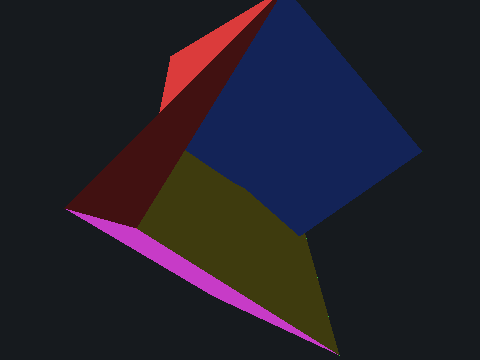

# Whisker 3D 引擎（定点软件光栅化）

用 **Whisker 语言**（零 C / 零 libc / 零浮点）实现的软件 3D 引擎：固定管线 +
Z-buffer 隐藏面消除 + 平面着色 + GDI 窗口呈现。**单文件、无任何依赖。**



## 运行

```powershell
# 构建（拼接引擎 + 场景，CLI 传参）
powershell -File build.ps1

# 窗口模式（~320 FPS @ 480x360；方向键旋转、ESC 退出）
.\cube3d.exe

# 无头模式（渲染 N 帧到 build/3d_frame*.px，供自动化验证）
.\cube3d.exe --headless
```

## 引擎架构

| 模块 | 实现 |
|---|---|
| 数学 | **定点数 16.16**（1.0 = 65536）：旋转矩阵、透视投影、barycentric 重心坐标 |
| 三角函数 | 运行时内置 256 步整圆正弦表（`sin16` / `cos16`，编译期由生成器写入） |
| 光栅化 | 边函数判定 + 包围盒遍历 + **Z-buffer**（每像素 8 字节深度） |
| 剔除 | 背面剔除（面积归一化）+ 屏幕外裁剪 |
| 着色 | 面法线（旋转后叉积）· 方向光 Lambert + 30% 环境光 |
| 呈现 | `winPresent`：StretchDIBits 把 BGRA 帧缓冲推到 GDI 窗口客户区 |
| 输入 | `keyAsync`（GetAsyncKeyState）：方向键旋转、ESC 退出 |

## 性能

- 窗口模式实测 **~320 FPS @ 480×360**（纯 Whisker 紧密循环）
- 场景：12 三角形 / 8 顶点 / 全屏 Z-buffer 清理 + 深度测试

## 已知限制（刻意从简）

- 无浮点：语言尚无 float 类型，定点 16.16（乘法用 64 位中间值，精度足够演示级渲染）
- 近平面裁剪用"整体拒绝"（顶点进入近平面即弃三角形）——相机距离须保持安全
- 无纹理、无抗锯齿、无 keep-alive 之外的窗口缩放跟随（窗口大小变化时按客户区拉伸）
- 帧缓冲/深度缓冲走 bump 分配器，随进程生命周期一次性消耗

## 仓库拆分

- **语言与编译器**：[`mouse1fish/whisker-github`](https://github.com/mouse1fish/whisker-github)
- **EonOS 系统**（本 3D 引擎的宿主平台）：[`mouse1fish/eonos`](https://github.com/mouse1fish/eonos)
